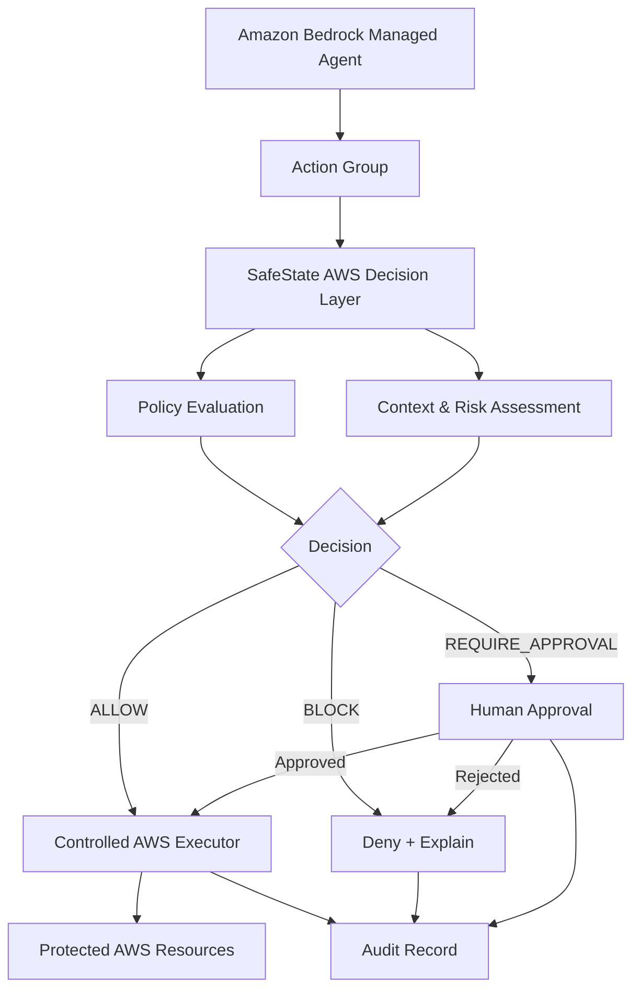

<!--
SafeState AWS
A standalone security and governance layer for autonomous AI agents operating on AWS.
-->

<div align="center">

# SafeState AWS

### Secure Governance for Autonomous AI Agents

**Let AI Agents Act. Keep Your Cloud Under Control.**

[](https://builder.aws.com/)
[](https://aws.amazon.com/)
[](https://aws.amazon.com/bedrock/)
[](#project-status)
[](LICENSE)

**A security and governance layer that evaluates agent-requested cloud actions before they reach protected AWS resources.**

</div>

---

## The challenge

AI agents are moving beyond conversation. They can reason, call tools, and perform operational tasks against real cloud environments.

That creates an important question:

> **How do we give AI agents the ability to operate cloud infrastructure without giving them uncontrolled power over it?**

An action can be technically available to an agent and still be unsafe in its current context. For example, deleting a production storage bucket, changing a network rule, or modifying a critical resource may have consequences far beyond the agent's immediate task.

IAM permissions remain essential, but agentic systems also need an explicit way to evaluate the intent, context, and potential impact of individual actions.

## The idea

**SafeState AWS** is an independent project exploring a governance layer for AI agents operating on AWS.

It places a controlled decision point between an agent's proposed action and the execution of that action. The system evaluates requests against security policies and risk rules, then returns one of three decisions:

| Decision | Meaning |
|---|---|
| **ALLOW** | The request satisfies the applicable policies and may proceed. |
| **BLOCK** | The request violates a policy or exceeds the accepted risk. |
| **REQUIRE_APPROVAL** | The request is sensitive and must wait for an authorized human decision. |

The objective is not to prevent agents from being useful. It is to make their actions **bounded, explainable, auditable, and accountable**.

## How it is intended to work

The initial design targets **Amazon Bedrock Managed Agents** and their action-group integration.



The diagram represents the **target design**, not a claim that all components are already implemented.

### Proposed request lifecycle

1. **Receive** — capture an action request from the agent integration.
2. **Normalize** — identify the requested operation, target resource, and relevant parameters.
3. **Evaluate** — check policy rules, permissions, resource sensitivity, and risk signals.
4. **Decide** — produce an explicit `ALLOW`, `BLOCK`, or `REQUIRE_APPROVAL` result with a reason.
5. **Enforce** — execute only through a controlled path when the decision permits it.
6. **Record** — preserve the request, decision, approval context, and execution outcome for audit.

## Core capabilities we are exploring

- **Policy-based enforcement** — express which agent actions are permitted, denied, or approval-gated.
- **Context-aware risk assessment** — consider the operation and its potential impact, not only whether an API call exists.
- **Human-in-the-loop approval** — keep people in control of sensitive or high-impact actions.
- **Least-privilege execution** — use narrowly scoped AWS identities and permissions.
- **Auditability** — retain structured records of decisions and execution outcomes.
- **Recovery-aware operations** — identify rollback or compensating-action options where the AWS service and operation support them.

## Example: a risky S3 operation

Imagine an agent requests deletion of a bucket identified by policy as production-critical.

1. SafeState identifies the requested operation and target.
2. The policy engine checks the resource classification and applicable rules.
3. The risk engine determines that the operation is destructive and high impact.
4. SafeState blocks the request or requires explicit human approval, according to policy.
5. The decision and its explanation are recorded.

This is an illustrative scenario. The production-resource classification, policy rules, and approval workflow are part of the implementation work.

## Proposed AWS building blocks

| AWS service | Intended responsibility |
|---|---|
| **Amazon Bedrock Managed Agents** | Agent reasoning and orchestration. |
| **Bedrock Action Groups** | Integration point for agent-requested operations. |
| **AWS Lambda** | Policy decision and controlled execution functions. |
| **AWS IAM** | Least-privilege identities and resource permissions. |
| **Amazon DynamoDB** | Potential storage for policies, approval state, and audit metadata. |
| **Amazon CloudWatch** | Logs, operational visibility, and monitoring. |

The final service selection and deployment topology will be validated during implementation. AWS-native controls such as IAM remain the underlying authorization boundary; SafeState is intended to complement, not replace, them.

## Design principles

1. **Default to explicit control** — no protected action should bypass the enforcement path.
2. **Separate decision from execution** — evaluating an action and performing it are distinct responsibilities.
3. **Least privilege everywhere** — the agent and executor should not receive broad permissions by default.
4. **Explain every decision** — policies should produce understandable reasons, not opaque outcomes.
5. **Treat destructive actions differently** — irreversible or high-impact operations need stronger safeguards.
6. **Be honest about recovery** — not every cloud operation can be rolled back; recovery must be operation-specific and tested.

## Project status

**SafeState AWS is currently in its initial design and implementation phase.** This repository is the standalone home of the AWS hackathon project.

| Area | Status |
|---|---|
| Product vision and scope | Defined |
| Initial architecture | Proposed |
| Threat model and security requirements | To be developed |
| Decision engine | Not implemented yet |
| Policy enforcement | Not implemented yet |
| Human approval workflow | Not implemented yet |
| AWS integration and demo | Not implemented yet |
| Automated security tests | Not implemented yet |

The roadmap will be updated as working components are implemented and tested. Features will not be described as complete until they are demonstrated.

## Roadmap

- [ ] **T01 — Project foundation:** repository standards, documentation structure, development conventions.
- [ ] **T02 — Architecture and threat model:** trust boundaries, abuse cases, security assumptions.
- [ ] **T03 — Decision engine:** normalized action model and deterministic decision contract.
- [ ] **T04 — Policy enforcement:** allow, block, and approval-required policies.
- [ ] **T05 — Bedrock integration:** connect a Managed Agent action group to the SafeState decision path.
- [ ] **T06 — Human approval:** approval state, expiry, and safe resumption.
- [ ] **T07 — Audit trail:** structured and correlated decision records.
- [ ] **T08 — Demonstration and validation:** end-to-end scenarios, negative tests, and documented limitations.

## Repository structure

The repository will evolve toward the following organization:

```text
safestate-aws/
├── docs/                  # Architecture, threat model, decisions, roadmap
├── src/
│   ├── agent/             # Agent integration
│   ├── policy_engine/     # Policy evaluation
│   ├── risk_engine/       # Risk assessment
│   ├── approval/          # Human approval workflow
│   ├── executor/          # Controlled AWS operations
│   └── audit/             # Decision and execution records
├── infrastructure/        # Infrastructure as code
├── tests/
│   ├── unit/
│   ├── integration/
│   └── security/
└── README.md
```

This is the planned layout; directories will be added when their implementation begins.

## Security boundaries and limitations

SafeState is an additional governance layer, **not a replacement for AWS IAM, service authorization, network controls, or security monitoring**.

The design must account for bypass attempts, confused-deputy risks, replayed approvals, stale policy data, compromised credentials, and failures in the decision service. Protected resources must remain inaccessible through alternate paths that bypass the enforcement layer.

Rollback is not universally possible. Destructive and external side effects require operation-specific safeguards and, where appropriate, compensating procedures rather than a blanket promise of reversibility.

Please do not submit credentials, access keys, tokens, private customer data, or sensitive infrastructure details in issues or pull requests.

## Relationship to SafeState Linux

SafeState AWS is a **separate, standalone project** created for the AWS hackathon.

It is conceptually inspired by the broader principle of controlled and accountable execution, but it does not depend on, extend, or modify the SafeState Linux codebase. It has its own architecture, implementation, dependencies, documentation, and roadmap. Any future relationship between the projects will be considered separately.

## Contributing

Ideas, constructive feedback, and security-focused discussion are welcome. Please read [CONTRIBUTING.md](CONTRIBUTING.md) once contribution guidelines are added, and report potential vulnerabilities privately rather than publishing exploit details.

## License

This project is intended to be released under the MIT License. The license file will be added as part of the repository foundation.

---

<div align="center">

**SafeState AWS**

*Let AI Agents Act. Keep Your Cloud Under Control.*

Built for the **AWS Builder Center — Agents, your rules: Bedrock Managed Agents** hackathon.

</div>
